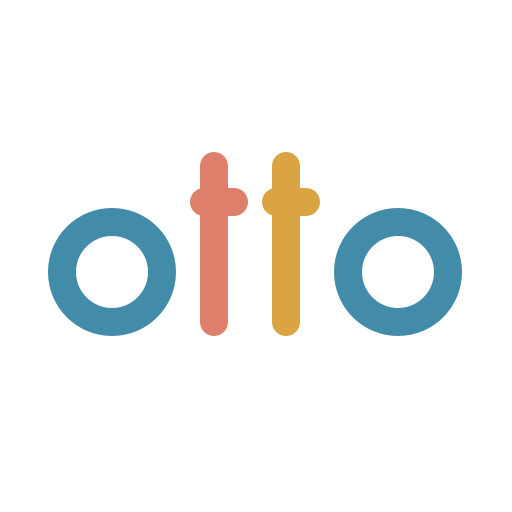

<p align="center">
  
</p>

<h1 align="center">Otto</h1>

<p align="center"><strong>Your agents, in one conversation.</strong></p>

<p align="center">English · <a href="README.zh-CN.md">简体中文</a></p>

Otto is a self-hosted **personal agent** built on **pi-durable** and **Cloudflare Durable Objects**. It remembers your conversations and ongoing work, and connects to coding agents on your own machines.

It runs either **in your own Cloudflare account** — one Worker and a Durable Object, nothing to operate — or as **a single Node process on a machine you own**, with one SQLite file you can copy ([self-hosted guide](docs/self-hosted.md)). The web workspace, the connector and the two surfaces are the same in both.

The name is just a name: short, the same word in every language, and quick to type as a command. The mark is the same word, drawn.

Talk to Otto in its web workspace. Ask it to work on a repository, follow up on a task, or pick up where you left off. Otto coordinates the work; a lightweight **connector** on each machine runs the local agents and brings back their progress and results.

- **One conversation across machines.** Keep track of tasks, follow-ups, and decisions in one place.
- **Your agents, on your computers.** Use pi, or Claude Code when installed, in repositories you choose to connect.
- **Context that lasts.** Conversation and task state persist server-side (a Durable Object, or the SQLite file on your own box). Full coding-agent session records stay on the machine and can be viewed while it is online.
- **Say what you meant, then stop it if you didn't.** One reply runs at a time; a queued message waits its turn, and the working row carries a stop control.

## Get started

Deploy Otto first — into your own Cloudflare account, or on a machine you own — then connect a machine where you want work to run. You will need a model-provider API key for Otto, and a Cloudflare account unless you self-host; Node.js **22.18+** is needed only for the agent path below, and for the connector. The connector supports **macOS and Linux** and needs a local coding agent with its own authentication configured.

### 1. Deploy your personal agent

**From your checkout.** Deploy this repository into your own Cloudflare account. The [deployment guide](docs/deploy.md) covers the whole runbook; from the repository root:

Before you start, generate and save a unique password of **at least 15 characters** in your password manager. Enter it as `LOGIN_PASSWORD`. Otto rejects shorter, common, or compromised passwords when it starts, even if Cloudflare accepts them in the deployment form.

```sh
pnpm install
wrangler deploy
wrangler secret put LOGIN_PASSWORD
wrangler deploy
```

When the build finishes, open the Worker URL and sign in; the setup wizard asks for your model provider's API key.

If deployment reports expired GitHub authorization, follow the [deployment troubleshooting guide](docs/deploy.md#deployment-troubleshooting). Changing the login password does not repair the GitHub connection.

**Or hand it to your coding agent.** Copy this into an agent that can run terminal commands on your computer:

```text
Deploy Otto, my personal agent, to my Cloudflare account.

Repository: a local checkout of otto — ask me for its path if you cannot find one.
Read docs/agent-deploy.md in that checkout and follow its runbook.

Check the prerequisites, deploy the Worker and Durable Object, configure
the secrets, verify access, and open the web workspace. Guide me through
Cloudflare authorization and entering my model API key directly in Settings.
Keep secrets out of chat and logs. Finish by verifying that Otto replies
to a message, then give me the deployment URL. I will connect my machines
separately using the connector setup prompt.
```

**Done when:** the web workspace opens and Otto replies to your first message. You can talk to Otto before connecting any machines.

**Or run it on your own machine.** No Cloudflare account: the same steward runs as one Node process beside its SQLite file, behind nginx or an SSH tunnel.

```sh
pnpm install && pnpm --filter @isaac2ingrid/steward build:node
# → ship dist/node/steward-node.mjs + ui/, set LOGIN_PASSWORD, start it under systemd
```

The [self-hosted guide](docs/self-hosted.md) covers the secrets file, the unit, TLS, upgrades, rollback and backups.

### 2. Connect your computer

Run your coding agent **on the machine you want Otto to work on**, then paste:

```text
Install the Otto connector on this machine and connect it to my existing
personal agent on Cloudflare.

Repository: a local checkout of otto — ask me for its path if you cannot find one.
Read docs/agent-connect.md in that checkout and follow its runbook.

Ask me for my Otto deployment URL and which local repositories to connect.
Check Node.js and my local coding-agent setup, install the connector,
and guide me through pairing from the web workspace's Machines page.
Start the connector, register only the repositories I choose, and verify
that this machine and its repositories appear online in Otto.
Keep long-lived credentials out of chat and logs. Finish with a small
read-only task to confirm the connection works end to end.
```

**Done when:** your machine is online in Otto and a read-only task returns a result. Repeat this prompt on any additional machine.

The connector makes an outbound connection to Otto; you do not need to open an inbound port on your computer. Your machine must stay awake and connected for local agents to run.

> If your agent cannot find the repository, point it at a local checkout. The connector runbook includes a source-install path when the npm package is unavailable. If `workers.dev` is unreachable from your network, the deployment runbook covers using a custom domain.

## Start a conversation

Once a machine is connected, try:

> “Review the login flow in my-app and tell me what you find.”
>
> “Fix that bug on my Mac using pi.”
>
> “Continue the previous task, and use pnpm this time.”

The workspace brings together messages, task threads, decisions that need you, connected machines, and session records. Replies appear as they are written, a message sent mid-answer queues behind it instead of interrupting, and the working row can stop that answer. Its interface supports English and Chinese.

## How it fits together

**You → Otto on Cloudflare → connector on your machine → pi / Claude Code**

The cloud agent uses **`@earendil-works/pi-durable`** for its agent runtime and a **Cloudflare Durable Object** for persistent state and coordination. Each connector maintains a WebSocket connection, starts local coding-agent sessions, and reports progress back to Otto. Your code and full session files stay on the machine; local coding agents use their configured model providers as usual.

The Cloudflare binding is the default, not a requirement: `apps/steward/node-host/` provides `ctx.storage`, alarms and sockets over `node:sqlite`, so the same `src/` runs on a plain Node process ([design](docs/design/node-host.md)).

## Go further

- [Deploy runbook](docs/agent-deploy.md) · [Connector runbook](docs/agent-connect.md) — instructions for your coding agent.
- [Deployment guide](docs/deploy.md) — manual deployment, model configuration, custom domains, costs, and updates.
- [Self-hosted runbook](docs/self-hosted.md) — the same steward on your own box: systemd, nginx, TLS, backups, upgrades.
- [Usage and API](docs/usage.md) — owner API, local agent behavior, and session viewing.
- [Architecture](docs/design/steward.md) · [Product spec](docs/spec.md) · [Routing eval](docs/routing-eval.md) · [Memory eval](docs/memory-eval.md) — for contributors.

## License

Otto is released under the [MIT License](LICENSE).
