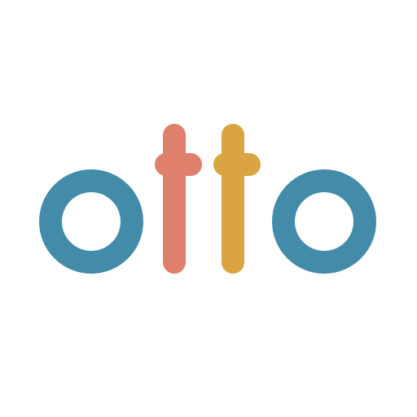

<p align="center">
  
</p>

<h1 align="center">Otto</h1>

<p align="center"><strong>汇聚你的所有 agent。</strong></p>

<p align="center"><a href="README.md">English</a> · 简体中文</p>

**Otto 是一个持续在线、协调你各台电脑上 coding agent 的个人智能体。** 你只需在一个网页工作台里对话；它记住持续进行的事项，把任务交给本机 agent，并把进展与待你决定的问题带回同一处。云端负责协调，本机 agent 才在你选定的仓库里执行代码工作。

- **云端总管，始终在线。** 即使电脑休眠，总管仍在云服务器上保留对话、记忆和定时回看；本地编码任务等连接器上线后才能执行。
- **多台机器，一处对话。** 任务、待决事项、后续安排和进展集中在一起。
- **代码留在自己的电脑上。** 连接器在本地运行 pi（或已安装的 Claude Code）；coding agent 的完整会话记录也留在本机。
- **有边界的记忆。** 偏好和项目约定与聊天记录分开保存，记录来源及确认状态；过时事实被取代和仅为腾空间而归档是两回事。
- **只读跟进 PR。** 把 GitHub PR 关联到已有事项，让服务器持续检查外部状态，不必让 coding agent 一直运行。通过对话创建或取消跟进，都需要你点击专用确认卡。
- **随时由你掌控。** 工作台显示正在进行的任务和需要你决定的事项；正在生成的回复可以停下。停止回复、停止 worker、取消 PR 跟进是三个独立操作。

## 架构

```text
网页工作台 / 可选的 Owner API
             │ HTTPS / WebSocket
             ▼
你的云服务器：Otto steward（Node.js + SQLite）
  ├─ 确定性核心：事件、期限、通知、持久队列
  ├─ 模型协调层：路由、判断、摘要、工具调用
  └─ 事项账本：Threads、待决事项、记忆、worker 状态
             ▲ connector 主动建立 WebSocket 连接
             │
macOS / Linux / Windows 上的 connector
  └─ pi 或 Claude Code → 你选定的本地仓库
```

云端状态保存在一个持久化 SQLite 数据库里；连接器主动连出，本机无需开放入站端口。仓库内容和 coding agent 的完整会话记录留在本机；云端与本地 agent 各用各的模型配置。**同一套协调逻辑**也可以部署在 [Cloudflare Workers + SQLite Durable Object](docs/design/node-host.md) 上；VPS 运行的是 Node 适配层，不是另一套产品。

## 技术设计与独特之处

- **用账本维持连续性，而不是无限加长提示词。** 事项（Thread）、worker 汇报和带来源的记忆独立于模型对话保存。每轮注入最新、限长的态势简报；对话压缩不会取代事项的事实记录。
- **确定的事交给代码，判断交给模型。** 状态流转、期限与常规完成通知无需模型调用；含糊的路由、问题处理和摘要才交给模型。模型不可用或超预算时，确定性兜底仍会把待决问题交给你。
- **行动有持久化边界。** 用户轮次先落库再执行，串行且可停止；已派发的 worker 不因此中断。幂等键和持久队列支持重试、重启恢复；事件触发的派发还要校验真实授权来源。
- **记忆可追溯、可控制。** 区分用户确认的事实、worker 汇报和推断，也区分「旧事实被取代」与「仅为腾空间归档」。详见[架构设计](docs/design/steward.md)和[轮次设计](docs/adr/0017-turns-are-serial-and-cancellable.md)。

### 从 Super Agent 对照中吸收与取舍

Otto 不是照搬 DeepSeek Super Agent；项目对照过三种思路，并记录了[实际落地与拒绝的部分](docs/plan/self-hosted.md#p4--product-follow-ups-from-the-super-agent-comparison)：

- **卡住任务的复审：** 可选的一次模型判断能重新规划 worker 任务或向你提问；`WATCHDOG_LLM` **默认关闭**，确定性的超时判定不会被模型推迟。
- **实时跟进事项：** 工作台通过 WebSocket 订阅 Thread 的事件和状态，用时间线游标续接，而不只是定时轮询。
- **不做推测式并行回答：** 前一轮未结束就启动下一轮，可能丢失上下文或重复派发同一意图。Otto 选择持久化、串行、可停止的轮次。

Otto 不是通用云端浏览器。可选的只读网页搜索（Tavily basic 或 Brave Search API）默认关闭，需单独配置密钥；它只返回限量摘要和来源链接，不能核验网页全文，也不是实时天气工具。需要本地执行的任务必须等连接器在线，但电脑休眠时云端仍能对话、记忆和安排回看。

可选的 **Web Push 提醒**支持兼容的电脑和手机浏览器，默认关闭。服务器配置 VAPID 密钥后，每台设备分别打开**账户／设置 → 手机通知 → 在此设备开启**，并允许浏览器通知；同一栏可以发送测试通知。只推送待决事项和任务完成的通用提示，不包含任务内容，默认按该设备时区在 22:00–08:00 静默。送达还取决于浏览器／系统权限及其推送服务，「测试通知已排队」不等于实际收到；应用内待办始终是兜底。iPhone 需先将 Otto 添加到主屏幕并从图标打开。详见[自托管手册](docs/self-hosted.md#web-push-optional)。

## 开始使用

你需要一台**长期在线的云服务器**运行总管（Linux、Node.js 24、服务管理器、持久磁盘和各台电脑可访问的 HTTPS 地址）。构建时使用 [`package.json`](package.json) 锁定的 pnpm 版本（若没有 `corepack` 命令，请先安装 Corepack）；登录后在工作台填写总管的模型 API key。连接器所在电脑需要 **Node.js 22.18+**（macOS、Linux 或 Windows），以及另行安装并完成登录／模型配置的本地 coding agent。总管的模型密钥不会替本地 agent 配置模型。

### 1. 把总管部署到云服务器

从代码检出目录在内存充足的机器上构建（可以用开发电脑构建，小规格 VPS 不必承担构建任务）：

```sh
corepack pnpm install --frozen-lockfile
corepack pnpm --filter @isaac2ingrid/steward build:node
mkdir -p apps/steward/dist/ui
cp -R apps/steward/ui/. apps/steward/dist/ui/
```

接着按[云服务器自托管操作手册](docs/self-hosted.md)，把 **`apps/steward/dist/node/steward-node.mjs`、`dist/ui/` 和运行时依赖 `ws`** 安装到服务器。把至少 15 个字符的独立 `LOGIN_PASSWORD` 和 `OTTO_PUBLIC_ORIGIN=https://<你的访问地址>` 写入受保护的 `.dev.vars`，明确设置 `OTTO_CONFIG_DIR`、`OTTO_DB_PATH`；由 systemd 管理进程并在故障后重启，进程只监听本机，前面用支持 WebSocket 转发的 HTTPS 反向代理。让云服务器及其持久磁盘 **7×24 小时运行**；在线备份 SQLite 请用 `.backup`，不要在 WAL 工作时直接拷贝数据库文件。不要提交密钥或把它发进聊天。

本机快照可以应对坏升级或误操作，但同一块 VPS 磁盘上的备份不能抵御整盘或实例丢失。只有可重建数据的试用阶段可以先从本机备份开始；积累重要、独有的历史后，再补异地加密备份和恢复验证。详见[备份说明](docs/self-hosted.md#backups)。

打开**你的云服务器的 HTTPS 地址**登录，在工作台的**设置**中填写总管的模型 API key。可选地在受保护的服务器环境中配置 `TAVILY_API_KEY`（或 `BRAVE_SEARCH_API_KEY`），让用户主动发起的对话能够只读搜索网页；它与模型密钥分开，未配置时功能关闭。服务器必须能被要连接的电脑访问；通过 SSH 隧道访问仅绑定本机的地址适合私人使用，但不是给其他电脑连接器使用的公网地址。

**完成标志：** 工作台能从预定地址访问，Otto 能回复消息。还没连接电脑时也可以先对话。

### 2. 连接电脑

在装有 Node.js 22.18+ 和已配置好的本地 coding agent 的 macOS、Linux 或 Windows 电脑上，安装已发布的连接器：

```sh
npm install --global @isaac2ingrid/otto
otto --version
```

在 Otto 工作台打开**机器 → 添加机器 → 生成配对命令**，然后在**要连接的电脑上**使用安装好的 CLI，填入实际部署地址和一次性配对码：

```sh
otto connect <你的-Otto-地址> <一次性配对码>
otto status
```

配对码十分钟后过期且只能使用一次，不要发进聊天或日志。配对会安装并启动后台服务（macOS 用 launchd，Linux 用 systemd 用户服务，Windows 用当前用户登录自启动：`Run` 注册表项加生成的 `~/.otto/otto-daemon.vbs`）；如果这台机器装不了（当前会话够不到服务管理器，或者机器策略禁止登录自启动），`connect` 会在**兑换配对码之前**就说清楚，重试不需要新码；也可以加 `--foreground` 把守护进程跑在当前终端里；如果机器已经配对、只是缺少自启动项，用 `otto install` 补上即可，它不需要配对码。`otto status` 会告诉你是哪一种；Windows 上连接器在下次登录时自动启动，启动器会以 `otto daemon --supervise` 方式运行它，所以守护进程挂掉后会自己按退避策略重启，直到执行 `otto stop`。
连接器主动连向 Otto，电脑无需开放入站端口。在工作台**机器**页面只添加你选定的本地目录，然后用 pi 试一个小的只读任务。Otto 不传模型参数，本地 agent 用的是**它自己的默认模型**——先确认那个模型有可用额度（默认模型额度用尽后会回退到别的已登录服务商，最终只表现为 agent 侧报错）。`otto status` 会打印 Otto 实际启动的 agent 命令，若解析出的可执行文件不存在会显示 `NOT SPAWNABLE`（`OTTO_PI_COMMAND` 里带空格的路径必须给路径本身加引号；用 `node <launcher> …` 则可以完全避开这个问题）；机器没上线的排查用 `otto logs -n 50`；执行任务时电脑需要保持唤醒和联网。代理、无服务管理器或源码安装步骤见[连接器操作文档](docs/agent-connect.md)。

**完成标志：** 机器和选定目录显示在线，测试任务返回结果。其他电脑重复这一步。

## 开始对话

可以试试：

> 「检查一下 my-app 的登录流程，告诉我发现了什么问题。」
>
> 「用我 Mac 上的 pi 把这个 bug 修一下。」
>
> 「接着上次的任务做，这次用 pnpm。」

工作台把消息、任务线程、待决事项、已连接的机器和会话记录放在一起。回复边写边出现；中途发的消息排在当前回复之后。

### 不启动 worker，持续跟进 PR

在已有事项里发送：

> 「在这个事项下持续跟进 https://github.com/owner/repo/pull/42 ，仅看 commit statuses，每15分钟检查，期限1小时，通过后通知我。先给确认卡，不要启动 worker。」

核对卡片上的 PR、事项、证据范围、间隔和期限，再点**专用确认按钮**。模型只生成提案；回复「同意」、引用文字表示同意或回答普通问题，都不能授权执行。确认卡十分钟后过期。可以问「现在有哪些 PR 跟进？」查看状态；发送「取消 PR 跟进 `<编号>`」获得取消确认卡，取消同样需要点击专用按钮。

轮询、状态变化通知和重启恢复不需要调用模型，也不依赖连接器。服务器需要能读取目标仓库的 GitHub API；私有仓库所需的凭据只留在服务器。**Commit statuses 不等于 Checks/Actions**：`statuses-only` 始终披露未覆盖部分，完整范围遇到权限不足时不会静默降级。状态变绿不等于需求验收通过；跟进不会改代码、重跑 CI 或合并 PR。证据范围、限制和显式认证的 Owner API 详见 [PR 跟进说明](docs/pr-watches.md)。

试点已验证确认、活跃跟进取消、重启恢复及 synthetic status 到后台通知的链路；这不是对真实 CI 工作流或换 head 行为的验收，后两项仍是独立待验证项。

## 进一步了解

- [云服务器自托管操作手册](docs/self-hosted.md)：服务、反向代理、TLS、升级和备份。
- [连接器操作文档](docs/agent-connect.md)：配对、目录、代理和排错。
- [使用说明与 API](docs/usage.md)：Owner API、本地 agent 行为和会话查看。
- [PR 跟进说明](docs/pr-watches.md)：确认卡、GitHub 证据范围和持久只读跟进。
- [人工监督的改进流程](docs/design/otto-improvement.md)：保留实验、评测门禁和人工接纳，不是自主修改生产系统。
- [架构设计](docs/design/steward.md) · [产品规格](docs/spec.md) · [路由评测](docs/routing-eval.md) · [记忆评测](docs/memory-eval.md)：面向贡献者。

## 许可证

Otto 采用 [MIT License](LICENSE)。
