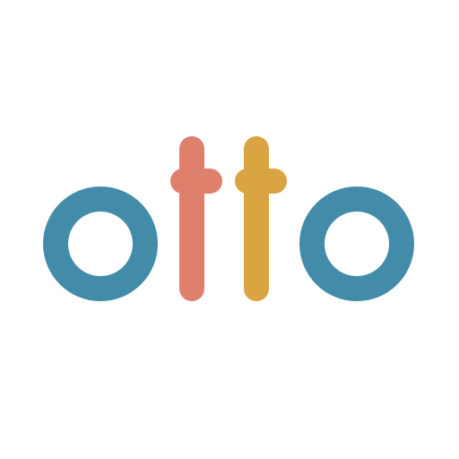

<p align="center">
  
</p>

# Otto connector

**English** · [简体中文](#otto-connector-简体中文)

`@isaac2ingrid/otto` installs the `otto` command. Otto is a self-hosted personal agent that runs in your Cloudflare account; the connector runs on a macOS or Linux computer and connects that computer to Otto. It keeps a WebSocket connection to your deployment, starts local coding agents such as pi and Claude Code, and reports their progress back to your personal agent.

The connector makes only an outbound connection. You do not need to open an inbound port on your computer.

## Requirements

- macOS or Linux
- Node.js 22.18 or newer
- npm 7 or newer
- A deployed Otto workspace
- A local coding agent, such as pi or Claude Code, installed and authenticated separately

## Install

Install the connector globally on the machine that will run your coding agents:

```sh
npm install --global @isaac2ingrid/otto
otto --version
```

Use a user-writable npm prefix. Do not use `sudo` to work around an npm permissions problem.

## Connect a machine

Open your Otto web workspace and go to **Machines → Add a machine → Create pairing command**. The workspace creates a one-time command:

```sh
npx @isaac2ingrid/otto connect https://otto.example.com <pairing-code>
```

If the connector is already installed globally, use the shorter form:

```sh
otto connect https://otto.example.com <pairing-code>
```

The pairing code is single-use and expires after 10 minutes. `connect` saves the device credential, installs a background service — launchd on macOS, a systemd user service on Linux, a per-user logon entry (the `Run` key plus a generated `~/.otto/otto-daemon.vbs`) on Windows — and starts the connector. The Windows entry starts the daemon under `otto daemon --supervise`, which restarts it with backoff after a crash — a `Run` value can start a process but never restart one. On a machine whose policy forbids that entry, or whose session cannot reach its service manager, add `--foreground` and keep the terminal open.

### Networks that block the deployment

`*.workers.dev` and similar hosts are unreachable from some networks (notably mainland China without a proxy). Pass a proxy so both the pairing request and the long-lived connection can get through:

```sh
otto connect https://otto.example.com <pairing-code> --proxy http://127.0.0.1:7890
```

With no `--proxy`, `connect` captures `HTTPS_PROXY` from the environment and stores it; the background service, git, and agent workers all inherit it. Check reachability any time with `otto doctor`, and inspect or change the stored proxy with `otto proxy`.

After pairing, open **Machines** in the Otto web workspace. Choose **Add directory** on the online machine, then select an existing directory or enter its absolute path. Otto detects a Git repository automatically; a plain directory works too, with no branch, worktree isolation, or PR support. Wait for registration to succeed before starting work. Repeat for each directory that Otto may use. No connector restart is needed.

Keep repository paths explicit. Do not register an entire home directory.

## Manage the connector

```sh
otto status                 # service, pairing, workers, and registered repositories
otto logs -n 50             # recent connector logs
otto stop                   # stop and disable start-at-login
otto start                  # enable and start
otto restart                # restart the background service
otto install                # install (or repair) the service for a machine that is already paired
otto upgrade                # install the latest package and restart
otto uninstall              # remove the service, preserve local state
otto daemon --supervise     # run the daemon in this terminal, restarting it on failure
```

State remains in `~/.otto/`. You can revoke a machine from the Otto workspace at any time.

## License

Released under the [MIT License](LICENSE).

## Documentation

The deployment and connector runbooks live in the Otto repository checkout:

- Deploy Otto — `docs/deploy.md`
- Connect a machine — `docs/agent-connect.md`
- Usage and agent behavior — `docs/usage.md`

---

# Otto connector 简体中文

`@isaac2ingrid/otto` 会安装 `otto` 命令。Otto 是部署在你 Cloudflare 账号里的 personal agent；connector 运行在 macOS 或 Linux 电脑上，把这台电脑接入 Otto。它保持到你部署地址的 WebSocket 连接，启动本地的 pi、Claude Code 等 coding agent，并把进展回传给 personal agent。

Connector 只主动发起出站连接，不需要在电脑上开放入站端口。

## 环境要求

- macOS 或 Linux
- Node.js 22.18 或更新版本
- npm 7 或更新版本
- 已部署的 Otto 工作台
- 已单独安装并完成认证的本地 coding agent，例如 pi 或 Claude Code

## 安装

在需要运行 coding agent 的电脑上全局安装：

```sh
npm install --global @isaac2ingrid/otto
otto --version
```

请使用当前用户可写的 npm prefix。遇到权限问题时不要用 `sudo` 绕过。

## 连接电脑

打开 Otto 网页工作台，进入 **机器 → 添加机器 → 生成配对命令**。工作台会生成一次性命令：

```sh
npx @isaac2ingrid/otto connect https://otto.example.com <pairing-code>
```

如果已经全局安装 connector，可以直接运行：

```sh
otto connect https://otto.example.com <pairing-code>
```

配对码只能使用一次，10 分钟后过期。`connect` 会保存设备凭证，安装并启动后台服务（macOS 用 launchd，Linux 用 systemd 用户服务，Windows 用当前用户登录自启动：`Run` 注册表项加生成的 `~/.otto/otto-daemon.vbs`；Windows 启动器会以 `otto daemon --supervise` 方式运行守护进程，崩溃后按退避策略重启）。机器策略禁止自启动、或当前会话够不到服务管理器时，可以加 `--foreground`，并保持终端打开。

### 无法直连部署地址的网络

部分网络（典型如未开代理的中国大陆）无法访问 `*.workers.dev` 等域名。请传入代理，让配对请求和长连接都能通过：

```sh
otto connect https://otto.example.com <pairing-code> --proxy http://127.0.0.1:7890
```

不传 `--proxy` 时，`connect` 会捕获环境变量 `HTTPS_PROXY` 并持久化；后台服务、git 和 agent worker 都会继承该代理。可随时用 `otto doctor` 检查连通性，用 `otto proxy` 查看或修改已存储的代理。

配对后，在 Otto 工作台打开**机器**，找到在线机器并点击**添加目录**。选择一个已有目录或输入其绝对路径，Otto 会自动检测是否为 Git 仓库；普通目录也能添加，只是没有分支、worktree 隔离和 PR 支持。等待登记成功后再开始任务。逐个添加允许 Otto 使用的目录，无需重启 connector。

请明确指定仓库路径，不要登记整个 home 目录。

## 管理 connector

```sh
otto status                 # 查看服务、配对、worker 和已登记仓库
otto logs -n 50             # 查看最近日志
otto stop                   # 停止并取消开机自启
otto start                  # 启用并启动
otto restart                # 重启后台服务
otto install                # 为已配对的机器安装（或修复）后台服务（不需要配对码）
otto upgrade                # 安装最新包并重启
otto uninstall              # 移除服务，保留本地状态
otto daemon --supervise     # 在当前终端运行守护进程，崩溃后自动重启
```

状态保存在 `~/.otto/`。你可以随时在 Otto 工作台撤销一台电脑。

## 发布（维护者）

发布的是 `@isaac2ingrid/otto`，scope 就是 npm 账号名本身。

**npm 已经停止新增 TOTP 2FA**（`npm profile enable-2fa` 现在直接报
`Adding a new TOTP 2FA is no longer supported`），所以没有"6 位验证码"可输。发布靠**安全密钥 +
浏览器按键**：先 `npm stage publish` 上传，再 `npm stage approve` 当场按指纹。

一次性准备：用 **Safari** 打开
<https://www.npmjs.com/settings/isaac2ingrid/tfa> 添加安全密钥（Touch ID 即可）。
注册必须走 Safari —— Chrome 会默认选"手机或平板电脑作为安全密钥"，等不到响应就报
`Device registration failed`；注册好之后用 Chrome 认证是没问题的。

```sh
cd apps/connector
pnpm build
npm stage publish --registry=https://registry.npmjs.org   # 输出 stage id
```

然后批准（会打开浏览器，按 Touch ID，命令自己继续）：

```sh
npm stage approve <stage-id> --registry=https://registry.npmjs.org
```

- `--registry` 在 `approve` 上不能省：`publishConfig.registry` 只对 publish 生效，不传就会打到本机
  npmrc 里的镜像，回 `404 /-/stage/***/approve not found`。
- `npm stage list` 看未批准的暂存件，`view <id>` 看详情，`reject <id>` 丢弃。暂存件会过期，过期就重新
  `stage publish`。
- 上传这一步用的是 `~/.npmrc` 里那把 `bypass 2FA` 的 granular token（它就是勾了 *Bypass two-factor
  authentication* 建出来的那种）；npm 正在逐步限制它，届时改用 `npm login --auth-type=web` 拿会话 token。
- 发布完确认：`npm view @isaac2ingrid/otto version`，再在干净目录跑
  `npx -y @isaac2ingrid/otto@0.2.0 help`。

## 许可证

采用 [MIT License](LICENSE)。
